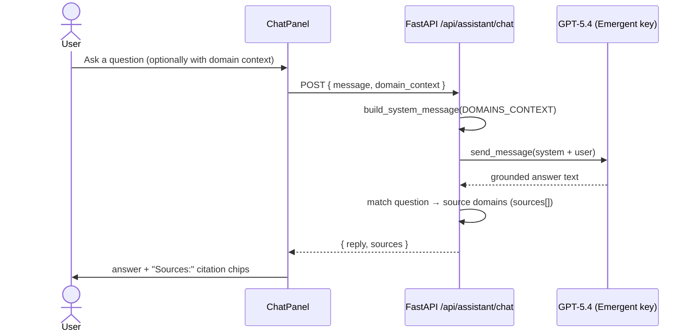
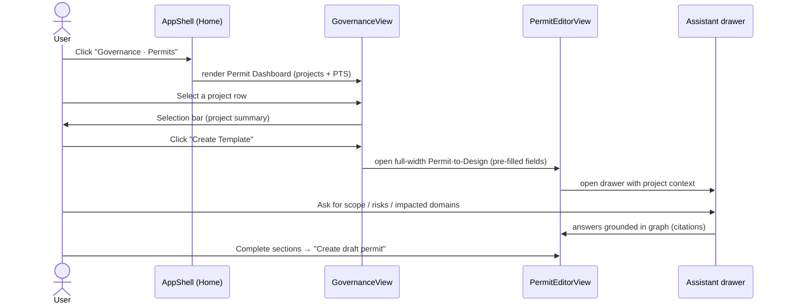
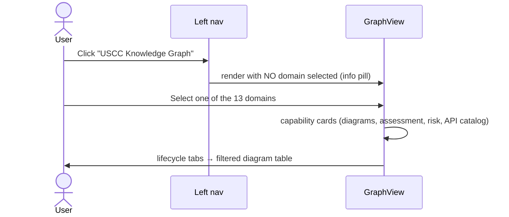
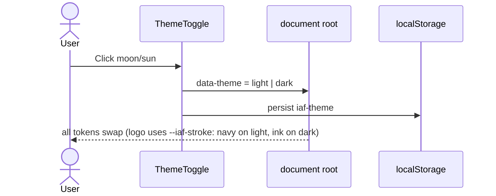

# iAF Sequence Diagrams

## 1. Sign-in (Emergent-managed Google OAuth)

```mermaid
sequenceDiagram
    actor User
    participant SPA as React SPA
    participant Auth as Emergent Auth (Google)
    participant API as FastAPI backend
    participant DB as MongoDB

    User->>SPA: Click "Enter iAF"
    SPA->>SPA: ProtectedRoute: GET /api/auth/me
    API-->>SPA: 401 (no session cookie)
    SPA->>User: Redirect to /login
    User->>SPA: Click "Continue with Google"
    SPA->>Auth: redirect: auth.emergentagent.com?redirect=<origin>/start
    Auth->>User: Google account chooser / consent
    Auth-->>SPA: 302 back to /start#session_id=...
    SPA->>API: POST /api/auth/session (X-Session-ID header)
    API->>Auth: GET /auth/v1/env/oauth/session-data
    Auth-->>API: { id, email, name, picture, session_token }
    API->>DB: upsert users; insert user_sessions (expires +7d)
    API-->>SPA: Set-Cookie: session_token (HttpOnly, Secure, SameSite=None)
    SPA->>SPA: strip hash → /start (signed in)
    Note over SPA,API: Every later page load calls GET /api/auth/me with the cookie
```

## 2. Knowledge Assistant (grounded chat with citations)



## 3. Permit-to-Design journey



## 4. Knowledge Graph explorer



## 5. Theming


